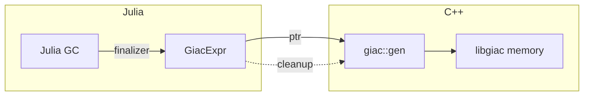

# Memory Management

This guide explains how Giac.jl manages memory for C++ objects, ensuring safe interoperation between Julia's garbage collector and GIAC's memory model.

## Overview

Giac.jl wraps C++ objects from the GIAC library. Since Julia's garbage collector doesn't know about C++ memory, we use Julia's finalizer mechanism to ensure proper cleanup.



### Key Principles

1. **Every C++ allocation has a corresponding deallocation**
2. **Finalizers ensure cleanup when Julia objects are garbage collected**
3. **Raw pointers are never exposed in the public API**
4. **Thread safety is ensured via locks**

## GiacExpr Lifecycle

Understanding the lifecycle of a `GiacExpr` is essential for safe development.

```mermaid
sequenceDiagram
    participant User
    participant GiacExpr
    participant Finalizer
    participant C++

    User->>C++: giac_eval("x^2")
    C++-->>GiacExpr: Create with ptr
    Note over GiacExpr: Register finalizer

    User->>GiacExpr: Use expression
    GiacExpr->>C++: Operations via ptr

    Note over User: GiacExpr goes out of scope
    User->>GiacExpr: (unreachable)

    Note over GiacExpr: Julia GC runs (any thread)
    GiacExpr->>Finalizer: Trigger finalizer
    Finalizer->>Finalizer: _giac_free_expr(ptr) queues the handle
    Note over Finalizer: next with_giac_lock
    Finalizer->>C++: handle dropped, giac::gen freed
```

### Creation

When a `GiacExpr` is created, a finalizer is automatically registered:

```julia
# In types.jl
mutable struct GiacExpr
    ptr::Ptr{Cvoid}

    function GiacExpr(ptr::Ptr{Cvoid})
        expr = new(ptr)
        finalizer(_finalize_giacexpr, expr)  # Register cleanup
        return expr
    end
end
```

### Usage

During its lifetime, the `GiacExpr` can be used normally:

```julia
x = giac_eval("x")
y = sin(x) + cos(x)  # Creates new GiacExpr objects
result = y.simplify()  # Method-style syntax also works
```

### Finalization

When the Julia GC determines the object is unreachable, the finalizer runs:

```julia
function _finalize_giacexpr(expr::GiacExpr)
    if expr.ptr != C_NULL
        _giac_free_expr(expr.ptr)  # Queue the handle (see "Freeing under the lock")
        expr.ptr = C_NULL  # Prevent double-free
    end
end
```

`_giac_free_expr` does not free anything itself: the finalizer may run on any
thread, at a moment when another thread is inside GIAC. It queues the handle,
and the next task to take the GIAC lock frees it.

## Finalizer Functions

Giac.jl defines three finalizer functions for its wrapped types.

### `_finalize_giacexpr`

Cleans up GIAC expression objects.

```julia
function _finalize_giacexpr(expr::GiacExpr)
    if expr.ptr != C_NULL
        _giac_free_expr(expr.ptr)
        expr.ptr = C_NULL
    end
end
```

**Called when**: A `GiacExpr` object is garbage collected.

### `_finalize_giaccontext`

Cleans up GIAC context objects.

```julia
function _finalize_giaccontext(ctx::GiacContext)
    if ctx.ptr != C_NULL
        _giac_free_context(ctx.ptr)
        ctx.ptr = C_NULL
    end
end
```

**Called when**: A `GiacContext` object is garbage collected.

**Note**: The `DEFAULT_CONTEXT` is never garbage collected during normal operation since it's referenced by the module.

### `_finalize_giacmatrix`

Cleans up GIAC matrix objects.

```julia
function _finalize_giacmatrix(m::GiacMatrix)
    if m.ptr != C_NULL
        _giac_free_matrix(m.ptr)
        m.ptr = C_NULL
    end
end
```

**Called when**: A `GiacMatrix` object that owns its handle is garbage
collected. A matrix built from an expression (`GiacMatrix(expr)`) borrows the
expression's handle, keeps the expression alive, and has no finalizer.

## Thread Safety

GIAC is not thread-safe, so Giac.jl serializes every call into GIAC with one
process-wide lock, `Giac.GIAC_LOCK`.

### The `with_giac_lock` Pattern

All evaluation operations use `with_giac_lock`:

```julia
const GIAC_LOCK = ReentrantLock()

function with_giac_lock(f)
    lock(GIAC_LOCK) do
        _free_doomed!()     # free what finalizers queued
        f()
    end
end
```

```julia
# In command_utils.jl
function giac_cmd(cmd::Symbol, args...)::GiacExpr
    # ... argument processing ...

    return with_giac_lock() do
        giac_eval(cmd_string)
    end
end
```

**Why ReentrantLock?** The same task can take it again in nested calls (an
operator calls a tier-1 helper that looks up a handle, each under the lock).
Holding a `ReentrantLock` also stops finalizers from running on that thread
until it is released.

### Freeing under the lock

Julia runs a finalizer on whichever thread collects garbage, possibly while
another thread is inside GIAC, and GIAC objects share reference-counted parts
whose counts are not atomic. A finalizer therefore never frees a GIAC object
nor touches the handle tables (`_gen_objects`, `_context_objects`). It only
queues what is to be freed, under a `Threads.SpinLock` (which a finalizer may
take), and the next call to `with_giac_lock` frees the queue:

| Queued by | What is freed under the lock |
|-----------|------------------------------|
| `GiacExpr`, `GiacMatrix` finalizer | the entry in `_gen_objects` |
| `GiacContext` finalizer | the entry in `_context_objects` |
| CxxWrap finalizer of a `Gen`, a `GiacContext` or a `std::vector<Gen>` | the C++ object itself |

Dropping a table entry only drops a reference: the `Gen` behind it may be
shared, and is destroyed by its own (queued) CxxWrap finalizer once nothing
refers to it. CxxWrap's finalizer is redirected by a method of
`CxxWrap.CxxWrapCore.delete` for these types (see `src/wrapper.jl`).

### Keeping the owner alive

A handle is a plain number. Once a function has read `expr.ptr`, `expr`
itself may be unreachable, and the collector may finalize it before the handle
is looked up; the handle is then gone (`<unknown>`, or an evaluation in the
default context for a collected `GiacContext`). Code that passes a handle on
keeps its owner alive with `GC.@preserve`:

```julia
function Base.:+(a::GiacExpr, b::GiacExpr)::GiacExpr
    with_giac_lock() do
        ptr = GC.@preserve a b _giac_add(a.ptr, b.ptr)
        # ...
    end
end
```

### Threads

Calling Giac from several tasks or threads at once is memory-safe: the calls
wait for one another on the lock, so there is no parallel speed-up for GIAC
work itself. A `GiacExpr` is a value and can be created on one thread and used
on another.

This holds for the package extensions too. Their conversions take the GIAC
lock around every call into the wrapper (`Giac.GiacCxxBindings`), with the
`GiacExpr` whose value they read kept alive under `GC.@preserve`, like the code
in `src/`:

| Extension | What runs under the lock |
|-----------|--------------------------|
| `GiacSymbolicsExt` | all of `to_giac(::Num)` and of `to_symbolics`: one lock around the whole tree walk |
| `GiacMathJSONExt` | all of `to_mathjson(::GiacExpr)` and of `to_giac` from a MathJSON expression |
| `GiacNemoExt` | the GIAC part only: building the GIAC tree in `to_giac`, reading the GIAC object in `to_nemo`. Nemo (FLINT) work runs outside the lock |
| `GiacSymPyExt` | the GIAC pass only (see below). No Python call is made under the lock |
| `GiacLibPARIExt`, `GiacTermInterfaceExt`, `GiacMCPExt` | nothing of their own: they call only Giac's API, which locks; PARI runs outside the lock |

The SymPy bridge never holds the GIAC lock while it calls Python: a thread
holding the GIAC lock while it waits for Python's GIL, while another thread
holds the GIL and waits for the GIAC lock, would deadlock. Each direction runs
in two passes over a small tree of plain Julia data. `to_sympy` reads the GIAC
object into that tree under the lock, then builds the `Sym` after releasing
it; `to_giac(::Sym)` reads the SymPy expression into the tree first, then takes
the lock to build the GIAC object. PyCall itself must be used from the thread
Python runs on, so run SymPy conversions on that thread (`@async` tasks, for
instance); other threads can use Giac meanwhile.

A test reads `ext/*.jl` and fails if a wrapper call can be reached from an
extension's entry point without the lock (`test/test_extensions_threads.jl`).
Helpers that make wrapper calls without taking the lock themselves expect
their caller to hold it.

What is **not** shared between threads is the default context. The C++
wrapper keeps the context used by every call that does not name one in a
`thread_local` variable, so each OS thread has its own: its own `:=`
bindings, its own settings (`Digits`, `complex_mode`, ...) and its own
assumptions (`assume`, `@giac_var x::positive`). A task that `Threads.@spawn`
runs on another thread does not see them:

```julia
@giac_var w::positive
giac_eval("a := 5")
string(Giac.Commands.simplify(sqrt(w^2)))           # "w"
fetch(Threads.@spawn string(giac_eval("a")))        # "a", not "5", on another thread
fetch(Threads.@spawn string(Giac.Commands.simplify(sqrt(w^2))))   # "abs(w)"
```

With one thread (`julia` started without `-t`) every task runs on the same OS
thread and shares the default context. With several, `Threads.@spawn` may run
a task on any thread, and Julia may move a task between threads when it
yields, so which context it sees is not even fixed for the task's lifetime.

Ways to work with this:

- Run work that depends on bindings, settings or assumptions on the thread
  that made them. `@async` tasks stay on the thread that starts them.
- Pass an explicit `GiacContext` to `giac_eval(string, ctx)`. Its bindings
  and settings are the same from every thread. Only `giac_eval` takes a
  context: arithmetic, `Giac.Commands`, `invoke_cmd` and the conversions use
  the default context of the thread they run on.
- Make each spawned task set up what it needs (its bindings, `Digits`,
  assumptions) itself, inside the task.

## Best Practices

### Do: Use Finalizers for New Types

If you create a new type that wraps C++ memory:

```julia
mutable struct MyNewType
    ptr::Ptr{Cvoid}

    function MyNewType(ptr::Ptr{Cvoid})
        obj = new(ptr)
        finalizer(_finalize_mynewtype, obj)  # Always register!
        return obj
    end
end

function _finalize_mynewtype(obj::MyNewType)
    if obj.ptr != C_NULL
        _my_free_function(obj.ptr)
        obj.ptr = C_NULL
    end
end
```

### Do: Check for Null Pointers

Always check before using pointers:

```julia
function safe_operation(expr::GiacExpr)
    if expr.ptr == C_NULL
        throw(GiacError("Expression has been freed", :memory))
    end
    # ... proceed with operation
end
```

### Do: Use the Lock for Evaluation

Always use `with_giac_lock` when calling GIAC:

```julia
function my_custom_eval(expr::GiacExpr)
    return with_giac_lock() do
        # All GIAC calls inside the lock
        result = giac_eval(string(expr))
        return result
    end
end
```

### Don't: Expose Raw Pointers

Never expose `Ptr{Cvoid}` in public API:

```julia
# Bad: Exposes internal pointer
function get_ptr(expr::GiacExpr)
    return expr.ptr  # Don't do this!
end

# Good: Return wrapped type or Julia value
function get_value(expr::GiacExpr)
    return to_julia(expr)  # Returns proper Julia type
end
```

### Don't: Rely on the Default Context Across Threads

Sharing a `GiacExpr` between threads is safe, but bindings, settings and
assumptions of the default context are per OS thread (see [Threads](@ref)):

```julia
# Wrong with several threads: the assumption is made on the main thread only
@giac_var w::positive
Threads.@threads for i in 1:10
    Giac.Commands.simplify(sqrt(w^2))     # abs(w) on the other threads
end

# Better: an explicit context, set up once, shared by every thread
ctx = GiacContext()
giac_eval("assume(w > 0)", ctx)
Threads.@threads for i in 1:10
    giac_eval("simplify(sqrt(w^2))", ctx)   # w
end
```

### Don't: Manually Free Memory

Let finalizers handle cleanup:

```julia
# Bad: Manual memory management
expr = giac_eval("x")
_giac_free_expr(expr.ptr)  # Don't do this!
expr.ptr = C_NULL

# Good: Let Julia GC handle it
expr = giac_eval("x")
# Just let it go out of scope
```

## Common Pitfalls

### Memory Leaks

**Symptom**: Memory usage grows over time without bound.

**Cause**: Finalizers not registered, or C++ objects created without wrapping.

**Fix**: Ensure every `Ptr{Cvoid}` from C++ is wrapped in a Julia type with a finalizer.

### Dangling Pointers

**Symptom**: Segmentation fault or garbage values.

**Cause**: Using a pointer after its memory has been freed.

**Fix**: Always check for `C_NULL` before using pointers; don't manually free memory.

### Race Conditions

**Symptom**: Intermittent crashes or wrong results with multithreading.

**Cause**: Multiple threads accessing GIAC without synchronization, a
finalizer freeing GIAC objects outside the lock, or a handle used after its
owner was collected.

**Fix**: Use `with_giac_lock` for all GIAC operations, free GIAC objects only
from the queue `with_giac_lock` empties, and hold the owner of a handle under
`GC.@preserve` while the handle is in use. If results differ between threads
only, see [Threads](@ref): the default context is per thread.

### Double Free

**Symptom**: Crash with "double free or corruption" error.

**Cause**: Memory freed twice, often from manual `_giac_free_*` calls.

**Fix**: Never call free functions manually; let finalizers handle it. Set pointer to `C_NULL` in finalizer to prevent double-free.

## Debugging Memory Issues

### Using Julia's GC

Force garbage collection to trigger finalizers:

```julia
GC.gc()  # Run garbage collector
```

### Checking for Leaks

Monitor memory usage:

```julia
function memory_test()
    initial = Sys.maxrss()
    for i in 1:10000
        x = giac_eval("x^$i")
    end
    GC.gc()
    final = Sys.maxrss()
    println("Memory change: $(final - initial) bytes")
end
```

### Pointer Validation

Check if a pointer is valid:

```julia
function is_valid(expr::GiacExpr)
    return expr.ptr != C_NULL
end
```

## See Also

- [Package Architecture](architecture.md) - Type definitions in types.jl
- [Troubleshooting](troubleshooting.md) - Debugging memory-related errors
- [Performance Tiers](tier-system.md) - How tier wrappers handle pointers
